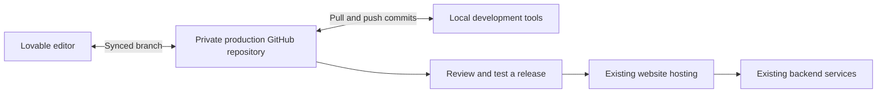

# Work outside Lovable while keeping Lovable available

Research date: November 2, 2026. Status: planning only. No account connections, repository creation, deployments, backend changes, or paid requests were performed.

## 1. Recommended direction

Yes, Lovable supports connecting an existing Lovable project to GitHub and syncing code in both directions. We can use local development tools and continue editing the same project in Lovable. That does not require moving the live website or database. See [Lovable's GitHub integration](https://docs.lovable.dev/integrations/github).

I recommend starting with that shared development workflow. Keep the current hosting and backend in place, prove that a small change can travel through both tools, and decide about hosting or database migration later. Moving everything at once adds work without helping us establish local development.

This plan is for the actual production project currently in Lovable. This AI_Wrapper repository holds the reference plans; it should not become the production repository by accident. The production project's code, architecture, backend, and deployment have not been inspected here.

## 2. How the pieces fit together

| Piece | Plain-language meaning |
|---|---|
| Lovable | An editor and development platform. It may also host the website and backend services. |
| GitHub repository | A versioned copy of the source code. It records changes and allows review. It is not automatically a copy of the running application or its data. |
| Local checkout | A copy of that repository on a developer's computer, where another editor or coding tool can work. |
| Branch | A separate line of code changes. It does not create a separate database, user directory, or provider account. |
| Pull request | A proposed change that can be reviewed before merging into another branch. |
| Hosting | The service running the web application for visitors. It can stay where it is while code is edited elsewhere. |
| Backend | The database, authentication, storage, functions, and other remote services the application calls. These need their own configuration and access controls. |

The proposed code path is:

The arrows describe our intended workflow, not a deployment configuration already in place. Code synchronization, backend deployment, and publishing are separate operations.

## 3. Choose the scope of the move

| Approach | What changes | Recommendation |
|---|---|---|
| Shared development | Add GitHub and local editing. Retain Lovable and current hosting/backend. | Start here. This directly meets the current goal. |
| External web hosting | Continue using Lovable/GitHub for development, but deploy the web app to another host. Retain the backend initially if compatible. | Consider only after local development works or a concrete hosting requirement appears. |
| Full platform migration | Move hosting and backend services, transfer data, and replace remaining managed dependencies. Lovable may remain an editor if the project stays compatible. | Treat as a separate project with its own testing, costs, cutover, and rollback plan. |

Lovable documents these as separate portability choices. The actual code determines hosting requirements: its documentation distinguishes older React/Vite projects from newer TanStack Start projects that also run server code. We must inspect the production project rather than assume it matches this Next.js prototype. See [deployment and ownership options](https://docs.lovable.dev/tips-tricks/deployment-hosting-ownership).

## 4. First inspect the production project

Before connecting or changing anything, record:

- The Lovable project URL, workspace owner, and who can manage Git integration.
- Whether a Git repository is already connected, its owner, visibility, active synced branch, and current sync status.
- The published URL, custom domain if any, and how a release currently happens.
- The actual framework, runtime, package manager, lockfile, build/start commands, and existing tests.
- Whether the backend is Lovable's built-in Cloud, a separately connected Supabase project, another provider, or absent.
- Which environments exist for development, testing, and production. Record backend identifiers and credential names/presence without copying secret values into this document or chat.
- Which functions, migrations, jobs, Google sign-in settings, uploads, payment events, and AI integrations require remote services.
- Whether any GitHub push or branch merge currently triggers an external deployment or another side effect.

Lovable's [built-in backend](https://docs.lovable.dev/features/cloud) uses Supabase's open-source foundation, but that does not establish that the project is an independently managed Supabase project already visible in the owner's Supabase dashboard. Confirm the actual arrangement and access before planning backend work.

The output of this step should be a short environment map with known facts and unresolved items. We do not need to redesign the application to create that map.

## 5. Connect GitHub without replacing the project

If the project already has a working Git connection, retain it and use that repository. Do not disconnect it just to start local work.

For an unconnected project, the current documented route is Project settings → Git → GitHub. A workspace owner/admin establishes the GitHub connection, and an authorized project/workspace owner/admin links the project. Lovable creates a new repository, private by default. Confirm the intended GitHub owner and visibility before proceeding. The integration does not attach the project to an arbitrary existing repository. Disconnecting and reconnecting creates a new repository. See [GitHub connection setup and limitations](https://docs.lovable.dev/integrations/github).

Our proposed setup checks are:

1. Use a GitHub account or organization controlled by the production owner, with strong authentication and recovery access.
2. Review the GitHub App's requested access and limit access to the intended repositories where supported. Confirm that any organization approval is complete.
3. Keep the production source private unless there is an explicit decision to publish it.
4. Wait for the initial sync and inspect the resulting repository. Confirm it contains the expected project and that no private credentials or user media were accidentally committed.
5. Record the baseline commit and active synced branch before making the first outside edit.

This step creates access to the code. It should not include a database migration, a domain change, a new AI provider, or a production release.

## 6. Establish local development safely

Clone the actual production repository into its own folder and inspect its README, dependency scripts, and configuration before running installation or development commands. Use that project's runtime and lockfile. Do not copy the commands, environment files, or provider credentials from AI_Wrapper.

Create a local feature branch, for example `codex/local-development-check`. Keep the first change small and reversible, such as a nonfunctional text correction. Avoid starting with authentication, payments, database structure, or generation behavior.

Before starting the application, identify the destination of each remote call. A local browser and a Git branch do not isolate remote data. Our proposed rule is to use a separate non-production backend with permitted test data for writes. If one is not available, begin with source inspection and mocked/read-only verification, and establish an approved test environment before write tests. Keep AI, email/SMS, payment, and generation calls mocked or disabled until explicitly needed.

Secrets should remain in the appropriate ignored local configuration or server secret store. A publishable backend key can be intentionally public; a database password, elevated service credential, or provider API secret cannot. Variables exposed to a browser build must contain no secrets. See [Lovable's secrets guidance](https://docs.lovable.dev/features/secrets).

Not every managed feature will work on a laptop unchanged. Lovable's local-development guide distinguishes remote Edge Function calls from server code running locally; managed AI/connector credentials may be unavailable to a local server. Classify any failure by the service it needs rather than inserting privileged credentials into browser code. Keep an integration mocked locally and verify it in an appropriate remote test environment when necessary. See [local environment and backend-file behavior](https://docs.lovable.dev/integrations/git-sync-overview#check-the-environment-before-you-run-the-app).

The result should be a reproducible local setup note and a list of supported local tests, remote-only checks, and disabled billable operations.

## 7. Keep Lovable and local work coordinated

Lovable syncs one active branch at a time. Other local feature branches reach that project after a merge into the synced branch or an intentional branch switch. Its docs recommend avoiding history rewrites on the synced branch. See [the Git sync workflow](https://docs.lovable.dev/integrations/git-sync-overview#keep-lovable-and-your-work-on-separate-branches).

Our proposed working agreement is:

- Let an in-progress Lovable edit finish and confirm sync before pulling, merging, or switching tools.
- Develop local changes on a feature branch and submit a pull request with relevant checks and a clear description.
- Do not ask Lovable and a local tool to edit the same change concurrently.
- Preserve normal review protections. If the main branch requires pull requests, give Lovable an appropriate working branch and review its work too, rather than granting a blanket bypass.
- Check the active branch and sync status after handoff. If histories diverge, preserve both sets of commits and reconcile them before pushing again. Do not force-push or discard one side to make the status look clean.
- Put lasting behavior constraints in project instructions and meaningful tests. Treat future AI-generated edits as code changes requiring review.

Define one release owner and one reviewed path to production. If branch protection causes a sync problem, investigate the rejected update and use the documented recovery/review path. Do not disable protection or disconnect/reconnect as the first remedy.

## 8. Prove the complete handoff before substantial work

Use a small change with no remote side effects:

| Check | Evidence to retain |
|---|---|
| Local checkout matches the project | Repository URL, baseline commit, and correct branch. |
| Local application can run | Exact setup commands and which services were mocked or contacted. |
| Change passes relevant checks | Test/build results appropriate to that project and a reviewed diff. |
| Reviewed commit reaches Lovable | Matching synced commit and the expected code/preview behavior. |
| Lovable remains usable | A controlled follow-up edit appears in the repository and can be pulled locally. |
| Rollback is understood | A revert-commit procedure and a distinction between code rollback and data recovery. |

Publishing should be a separate deliberate step after preview verification. Lovable publishes a snapshot; consult its [publishing workflow](https://docs.lovable.dev/features/publish). Also inspect any external deployment automation before the first push, because another connected host may deploy independently of Lovable.

Successful code sync does not prove the live application, database policies, or remote integrations are correct. Record the limits of the handoff test rather than calling it a production security review.

## 9. Handle backend changes through a separate reviewed process

The [Git sync documentation](https://docs.lovable.dev/integrations/git-sync-overview#backend-files-in-your-commits) states that synced migration and Edge Function files are not automatically applied/deployed by Lovable. Identify the actual deployment authority and record its procedure before changing them. A code branch is not a backend staging environment.

For future backend work, require a reviewed migration/function change, a confirmed target environment, appropriate backup/recovery, testing against permitted non-production data, and an explicit release sequence. Coordinate application compatibility with schema and RLS changes. Do not apply the same migration independently through several tools without tracking what already ran. Reverting frontend code does not reverse database writes or a schema change.

Use [the production security plan](production-security-plan.md) to assess RLS, privileged credentials, private storage, request limits, and protected output release against the actual project. This integration plan does not establish that Lovable's generated controls meet those requirements.

For Google login, determine whether the project uses managed Google authentication or its own credentials. Register the required local/test/production destinations with the actual auth service and preserve callback/return-path validation. Do not replace the working auth provider merely to add a local URL. Lovable documents its built-in-backend choices in [Google authentication](https://docs.lovable.dev/features/google-auth); separately connected auth services need their own configuration.

## 10. Move hosting or data only if there is a later reason

An external-hosting decision should follow a working local setup and a concrete requirement, such as a missing runtime capability or a release-control requirement. First test a private/non-production deployment with the current backend where suitable. Validate routing, refresh/deep links, Google login, cookies, permissions, uploads, remote functions, and failure handling before considering a domain cutover.

Code export does not transfer database records or stored file bytes. A full move also needs a separate inventory of authentication identities, sessions, policies, function deployments, schedules, secrets, payment callbacks, AI integrations, and storage objects. Plan preservation of user/resource identity and verify actual migration support rather than promising existing logins or passwords will transfer unchanged. Lovable's [external deployment guide](https://docs.lovable.dev/tips-tricks/external-deployment-hosting) describes these boundaries and stack-specific hosting requirements.

Before any data move, verify what backups/exports contain and test restoration separately. A database backup is not automatically a backup of stored files, provider configuration, and application secrets. See [Lovable's database backup/export documentation](https://docs.lovable.dev/features/database-backups).

Our proposed migration gate requires a tested destination, reconciled data and job/billing state, a plan for writes during cutover, tested authentication, confirmed private-media/RLS behavior, a rollback owner, and monitoring. Keep the existing service available until the agreed verification passes. GitHub sync alone does not meet this gate.

## 11. Completion criteria and next information needed

The first phase is complete when the production owner controls the correct private repository, local development works with documented service boundaries, a reviewed small change completes both directions of sync, and Lovable remains available without an unintended production or backend change.

To apply this plan, we need the Lovable project link and confirmation of any existing GitHub connection. Inspect the backend and framework next; it is fine if the owner does not know those details yet. No credentials need to be pasted into chat. If required permissions are missing, identify the owner who can connect the account and continue the source/environment preparation that does not need that permission.

Public documentation supports this workflow as of the research date. The actual project's roles, plan features, existing integrations, deployment automation, and local compatibility remain unverified. Recheck the linked instructions when execution begins.
